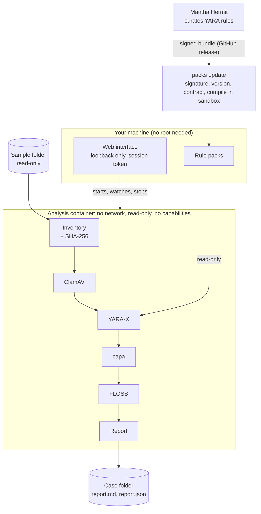

# Mantha Ray

Mantha Ray is a local static malware-triage tool for Linux. Point it at a suspicious folder, such as a cracked game or a download you don't trust, and it tells you which files deserve a closer look, without ever running them.

Every file is inventoried and hashed, then checked by ClamAV signatures, YARA-X rule packs, capa capability analysis and FLOSS string extraction. All analysis runs in a hardened Docker container with no network access. A local web interface shows live progress, a file tree with per-file results, and saved reports.

> Static analysis can find strong evidence that something is wrong. It can never prove that a file is safe.

## Highlights

- **Six-stage static pipeline:** inventory, ClamAV, YARA-X, capa, FLOSS, report.
- **Isolated analysis:** a network-less, read-only container with no Linux capabilities, resource limits and a read-only view of the sample.
- **Signed rule packs:** YARA rules come from [Mantha Hermit](https://github.com/shashankmantha/mantha-hermit) as minisign-signed bundles, with rollback protection. Each rule is compiled in the sandbox before it's trusted. You can also add your own `.yar` files.
- **Built for big folders:**
  - files analyzed in parallel, smallest first;
  - scheduling around the container's memory, so a memory-hungry file runs alone;
  - identical files analyzed once;
  - per-file timeouts that grow with size;
  - a fast plain-strings pass for files too big for FLOSS.
- **Honest coverage:** every report says how many files were fully checked, and names each file an analyzer didn't finish (not reached, timed out, too large, out of memory) as a gap, never as clean.
- **Live interface:**
  - stage tracker and activity console;
  - a terminal-style queue showing which file is being analyzed;
  - file tree with per-analyzer badges;
  - saved scan history;
  - a stop button that keeps a report of the finished work.
- **Reports:** Markdown and JSON reports, raw tool output, and a short `summary.sh` view.

## How it works



| Stage | What it does |
| --- | --- |
| **Inventory** | Walks the folder safely (no symlink following, bounded depth and size), records type, size and permissions, and hashes every file with SHA-256. |
| **ClamAV** | Known-malware signatures, with a signature database that must be less than 7 days old. |
| **YARA-X** | Every file against the installed rule packs. Each rule's severity (`threat`, `suspicious` or `info`) comes from its pack. Skipped, not counted as a gap, when no packs are installed. |
| **capa** | What PE and ELF programs can do: injection, persistence, networking, anti-analysis and so on, with weighted risk scoring. |
| **FLOSS** | Stack, tight and decoded strings from Windows programs up to 4 MiB. Bigger files get a fast plain-strings pass filtered for URLs, mining pools, commands, credential paths and similar. |
| **Report** | A verdict, a "fully checked: N of M files" headline with every gap listed, per-file results, stage timings and resource use. |

### Verdicts

| Status | Meaning |
| --- | --- |
| **Known Detection** | ClamAV matched a known malware signature. |
| **High Concern** | A YARA-X `threat` rule matched. This applies even if other stages didn't finish. |
| **Suspicious Capabilities** | One file combines capabilities that together look like malware: code injection plus persistence, reading saved passwords plus network access, a keyboard hook plus network access, mining plus hiding, and so on, or uses one that legitimate software practically never needs (deleting shadow copies, a UAC bypass, patching AMSI). This also applies even if other stages didn't finish. |
| **Needs Review** | A YARA-X `suspicious` rule matched, or capa, FLOSS or the inventory found something a person should look at. |
| **No Indicators Detected** | Every stage finished and found nothing. This does not prove the files are safe. |
| **Incomplete** | A stage failed, timed out or didn't reach every file. |

### How capa is judged

capa describes what code *can* do, not what it's for, and games do much of what malware does: they read raw keyboard input, check for debuggers, take screenshots, download updates and run JIT-compiled code. So Mantha Ray judges each file on its own, never adds capabilities up across a folder, and treats those routine capabilities as context only. A file is flagged as **Suspicious Capabilities** only for a combination in that one file (or one of a short list of rules legitimate software doesn't need). `summary.sh` lists each flagged file with the capabilities behind it, and applies the current rules to older cases too.

### Coverage

Next to the verdict, every report says how many files were **fully checked**: every analyzer that applies to a file finished it (a match still counts as checked). ClamAV and YARA-X apply to every file, capa to Windows and Linux programs, and FLOSS to Windows programs. Files that were only partly checked (for example, plain strings instead of FLOSS's decoding) are counted separately, and every gap is listed with its reason in `report.json`, `report.md`, the web results and `scripts/summary.sh`. If no YARA rule packs are installed, YARA-X isn't counted, and the report says so.

## Security design

- **The sample is never executed.** Every analyzer is static.
- **The container:**
  - `--network none`, a read-only root filesystem, every Linux capability dropped, and `no-new-privileges`;
  - a non-root user, with CPU, memory and process limits;
  - a `noexec` temporary filesystem;
  - the sample mounted read-only.
- **No overlaps:** the source, results and rule pack folders can't overlap.
- **The result cache is read-only to scans.** The host adds results from finished cases, and only for files that case inventoried, under their own hash. The container can read the cache but never write to it.
- **The web interface** listens on loopback only, needs a per-launch session token, and checks the request origin. It sends a strict Content Security Policy, and puts filenames and strings from samples into the page as text, never as HTML.
- **Rule packs are untrusted until proven otherwise.** An install or update:
  1. verifies the minisign signature against the release key in this repository;
  2. matches the signed `mantha-packs <version> sha256:<hash>` comment exactly;
  3. checks the archive hash;
  4. refuses anything older than a bundle already installed (rollback protection);
  5. unpacks with no links, no path escapes and size limits;
  6. validates every manifest and pack hash;
  7. compiles every rule inside the network-less container with the image's own YARA-X.

  If any step fails, nothing changes. Only the host downloads; scan containers never get network access.
- **Stopping a scan** needs a two-second hold to confirm (or typing `stop` in the terminal script), so it can't happen by accident.

Docker shares the host kernel and is not a perfect security boundary. Analyze untrusted material inside a dedicated, disposable VM with networking, shared folders and clipboard sharing turned off. Never treat a clean report as permission to run a file.

## Quick start

Requirements: Linux on x86-64, Git, Python 3.11.4 or newer with `venv`, and Docker you can use without `sudo`. Per-distribution commands are in [docs/installation.md](docs/installation.md).

```bash
git clone https://github.com/shashankmantha/Mantha-Ray.git malware-scanner
cd malware-scanner
./scripts/check-requirements.sh
./scripts/setup.sh
mantha-ray
```

`setup.sh` does the following:
- creates `.venv` and installs Mantha Ray;
- builds the analysis image, which downloads ClamAV signatures, capa and its rules, FLOSS, and the YARA-X scanner (checked against a pinned hash). This needs internet access and takes several minutes the first time;
- checks the image and prints the tool versions;
- adds a `mantha-ray` command for your account (a link in `~/.local/bin`), so you never activate the virtual environment, and `mantha-ray packs update` works from any folder. `./mantha-ray.sh` in the repository does the same thing.

Run it again at least weekly to refresh ClamAV signatures; it reuses everything else.

Then install the latest signed rule packs:

```bash
mantha-ray packs update
```

## Using it

1. Run `mantha-ray`. It opens the interface in your browser.
2. Choose the folder to scan and where to save results (default `~/mantha-ray-results`; it can't be inside the scanned folder).
3. Pick a resource profile and select **Start secure scan**.
4. Watch the stage tracker. Switch between **Activity** (the live log) and **Queue** (every file in analysis order, with the current one marked).
5. Open the file tree. Each file shows a risk and a badge per analyzer (done, partial, finding, not applicable or failed), and expanding it shows why.

### Resource profiles

| Profile | CPUs | Memory | Parallel analyses | capa / FLOSS time budget |
| --- | --- | --- | --- | --- |
| Constrained | 1 | 2 GiB | 1 | 30 min each |
| **Balanced** (default) | 2 | 4 GiB | 2 | 1 h each |
| High | 4 | 8 GiB | 4 | 2 h each |
| Custom | any preset with your own limits | | | |

Big game folders need High: on Balanced, capa doesn't reach every program in a multi-gigabyte game within its hour. Whatever isn't reached is reported as a gap.

### Stopping a scan

**Stop scan…** asks for confirmation. Hold **Stop and save report** for two seconds to end the analyses in progress and save a report of the finished work; files not analyzed yet are listed as not reached. **Discard the scan instead** ends it and saves nothing. From a terminal:

```bash
./scripts/stop-scan.sh             # type "stop" to confirm; saves a report
./scripts/stop-scan.sh --discard   # type "discard" to confirm; saves nothing
./scripts/summary.sh               # short summary of the newest case
```

### Reusing earlier results

capa and FLOSS are the slow stages, so their complete results are saved by each file's SHA-256 and reused when a later scan finds an identical file. Reused results are marked in the report with the case they came from, and don't count against the file cap or time budget, so a second scan of the same folder spends its whole budget on the files the first one missed.

- **A changed file is always analyzed again.** One changed byte gives a different hash, so it can't match an old result.
- **Only finished work is saved.** Timeouts, failures and plain-strings-only passes never are, so those files get another try. ClamAV and YARA-X always run fresh.
- **A new capa or FLOSS version** (or different FLOSS string limits) means fresh analysis.
- **After every scan,** each file is hashed again and compared with the inventory. A file that changed while it was being scanned makes the case Incomplete and is listed by name.

```bash
mantha-ray cache status   # how many results are saved, and where
mantha-ray cache clear    # delete them all, so every file is analyzed afresh
```

## Rule packs

YARA rules ship as signed bundles built by [Mantha Hermit](https://github.com/shashankmantha/mantha-hermit) and published as releases of [mantha-packs](https://github.com/shashankmantha/mantha-packs).

```bash
mantha-ray packs update            # install the latest signed release
mantha-ray packs update --check     # only say whether there's a newer one
mantha-ray packs status            # what's installed
mantha-ray packs install FILE.tar.gz   # a bundle you downloaded (.minisig next to it)
mantha-ray packs rollback          # back to the previous install, on purpose
```

The **YARA rules** panel on the setup screen does the same: it shows the installed bundle and has a **Check for updates** button.

### Your own rules

Add your own `.yar` files in the **YARA rules** panel, or:

```bash
mantha-ray packs add my_rules.yar                    # a match means Needs Review
mantha-ray packs add miners.yar --severity threat    # a match means High Concern
mantha-ray packs add notes.yar --severity info       # listed only
mantha-ray packs remove my-rules
```

- **Checked first:** each file must compile in the scan container before it's kept.
- **Kept apart:** your rules are stored as a `local:<name>` pack beside the signed bundle. They're labelled as yours in reports, and bundle updates never touch them.
- **Supported:** modules such as `import "pe"`, and the `filename`, `filepath` and `extension` externals.
- **Not supported:** `include`.
- **Limits:** up to 50 files of 8 MiB each.

## Case output

```text
case-20261024T041611Z-5c8a4689/
├── report.md        human-readable report
├── report.json      structured report (schema 0.2.x)
├── files.jsonl      one inventory record per file, with SHA-256
├── manifest.json    case metadata and tool versions
├── logs/
└── raw/             bounded raw output from ClamAV, capa and FLOSS
```

Filenames and strings in reports come from the sample. Treat them as untrusted evidence, never as instructions.

## Limitations

- **Static only:** payloads that are encrypted, downloaded later or wait for a trigger aren't visible. Packed and protected programs hide code and strings from every analyzer; they're labelled, but not unpacked.
- **ClamAV** can't scan a single file over about 2 GiB, or spend more than 10 minutes on one file. Files over those limits are listed as coverage gaps.
- **Archives** are recognised but not unpacked. Only ClamAV looks inside them.
- **capa** is slow on large programs (a big game executable can take 20 minutes or more), and its risk score adds up across files, so large legitimate software can score high.
- **FLOSS** only deobfuscates programs up to 4 MiB; bigger ones get plain strings.
- **YARA-X** is only as good as the installed rules.
- **Platform:** x86-64 Linux with Docker only.

## Roadmap

Working towards a full scan of large game folders where every file is either proven identical to a known-good copy or fully analyzed:

- **An overnight "exhaustive" profile.**
- **Reference comparison** against a clean copy, such as a Steam install, so only added or changed files need full analysis.
- **Known-good library hashes** (OpenAL, FFmpeg, Visual C++, `steam_api`) and a wrong-hash check.
- **Safe archive unpacking**, and script analysis (Lua and others).
- **Speakeasy emulation** for Windows programs.
- **Scheduled rule pack updates.**

## Development

```bash
./scripts/test.sh                   # Python tests, shell syntax, frontend type check
./scripts/test.sh --python-only -v
./scripts/setup.sh --build-frontend # after changing files under frontend/ (needs Node.js)
cd frontend && npm run dev          # frontend dev server
```

The compiled interface is committed under `src/static_triage/web_dist/`, so Node.js is only needed to change it.

```text
malware-scanner/
├── Containerfile          analysis image: ClamAV, capa, FLOSS, YARA-X
├── mantha-ray.sh          launcher
├── scripts/               setup, tests, stop-scan, summary, requirement checks
├── frontend/              TypeScript + Vite web interface
├── src/static_triage/
│   ├── scanner.py         runs the stages (inside the container)
│   ├── inventory.py       safe tree walk and hashing
│   ├── clamav.py  yara_scan.py  capa.py  floss.py  plain_strings.py
│   ├── parallel.py        parallel, memory-aware scheduling
│   ├── reporting.py       verdict and reports
│   ├── packs/             bundle contract, signatures, install, update, your own rules
│   ├── container/         hardened Docker command and host controller
│   └── web/  web_api.py   local web service
└── tests/
```

**For maintainers:** the release public key is `src/static_triage/packs/minisign.pub` (key ID `BA7C3365DEC27B32`). The matching secret key is password-protected, kept off every repository, and backed up offline. Rotating it means shipping the new public key in a code update before signing with it.

More help: [docs/installation.md](docs/installation.md) and [docs/troubleshooting.md](docs/troubleshooting.md).

## Responsible use

Mantha Ray is for defensive analysis, education, incident response and authorized research. Only inspect files you're allowed to have and analyze, keep samples isolated, and don't use this project to distribute malware or to run suspicious software on systems you don't own.
